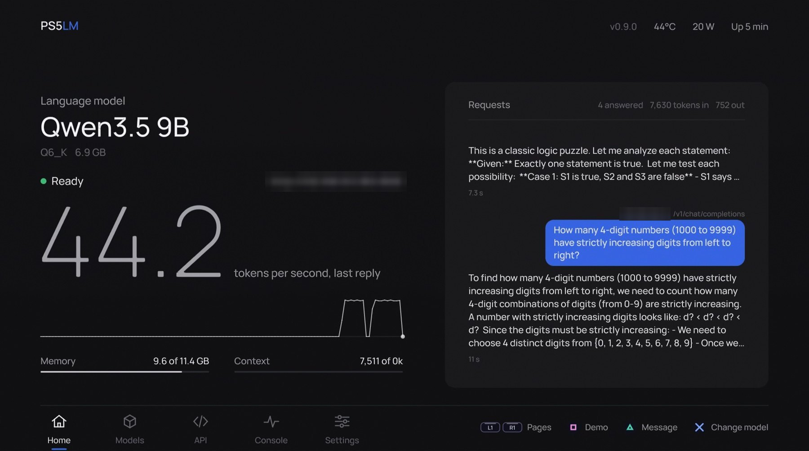
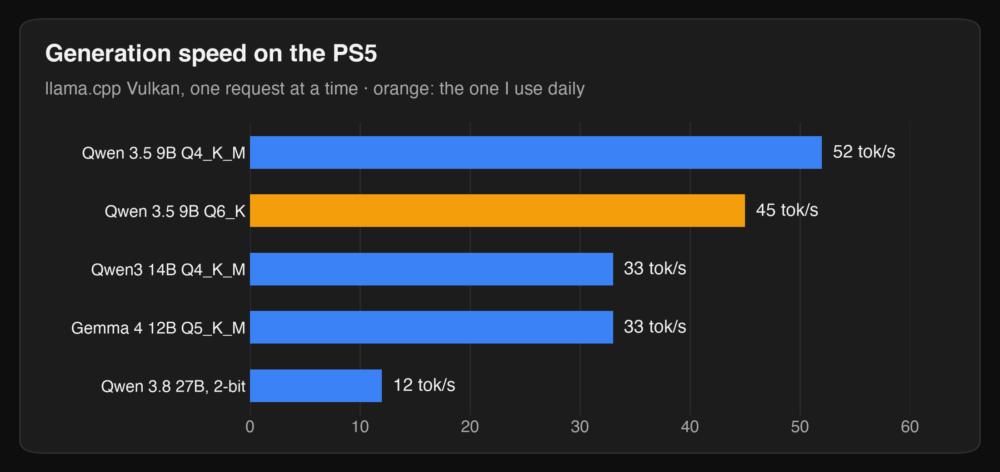
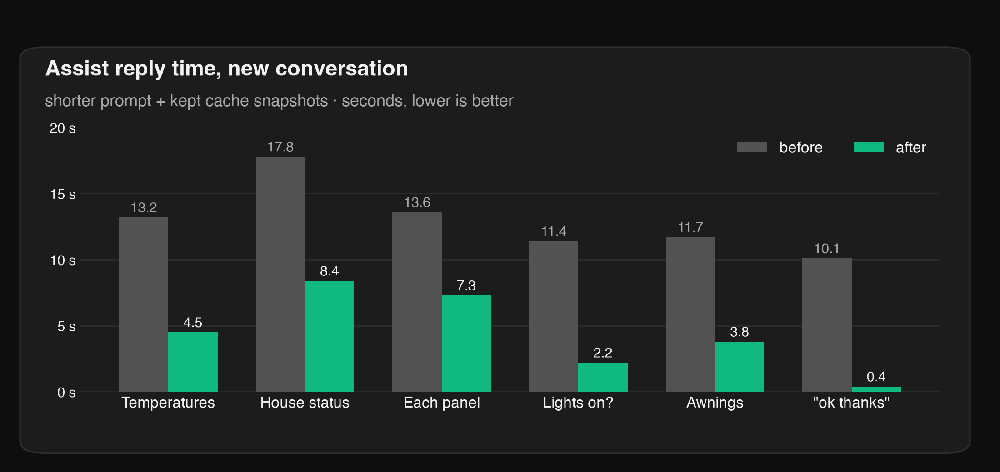

In late September the [Relapse](https://www.techpowerup.com/353259/new-jailbreak-unlocks-nearly-every-playstation-5-model)
exploit came out: a browser bug plus a kernel bug that jailbreaks every PS5 and PS5 Pro on
firmware 7.00 to 13.60. Sony's 14.00, released in early September, closes it. My PS5 had not been
updated, so I had a console with 16 GB of fast memory and nothing to play.

## PS5LM

[PS5LM](https://github.com/cobanov/PS5LM) by cobanov is a homebrew app that runs
[llama.cpp](https://github.com/ggml-org/llama.cpp) on the console's GPU through Vulkan. The console has 16 GB of unified
memory shared by the CPU and GPU, and about 12 GB of it is available to an app. PS5LM gives 11.4 GB
of that to the model and its context, and serves the usual APIs on port 8081: OpenAI's
`/v1/chat/completions`, Anthropic's `/v1/messages` and a chat page in the browser. Anything that
speaks OpenAI can use it.



The 20 W in the corner is the chip's own reading. At the wall plug it's about 110 W with the model
loaded.

It runs on top of the standard homebrew stack: etaHEN and kstuff after the exploit, and
ShadowMountPlus to put the app on the home screen.

Why a PS5 at all? Generating text is limited by memory bandwidth, because every token reads the
whole model once. The PS5 has 448 GB/s of GDDR6, more than an M4 Pro (273 GB/s). Qwen 3.5 9B at
Q6_K is 7.5 GB, so the ceiling is about 60 tokens a second. It does 45.

## Five models, one console

The console is on Ethernet with a fixed address. I tried five models and kept two.



| Model | Speed | Test score | Verdict |
|---|---|---|---|
| Qwen 3.5 9B Q6_K | 45 tok/s, 64K context | 7/11 | **daily driver** |
| Qwen 3.5 9B Q4_K_M | 52 tok/s | not run | same Assist answers, Q6 kept for quality |
| Qwen3 14B Q4_K_M, thinking on | 33 tok/s, 12K context | 11/11 | **kept for hard problems** |
| Gemma 4 12B Q5_K_M | 33 tok/s | 8/11 | best Greek, slow follow-ups |
| Qwen 3.8 27B, 2-bit | 12 tok/s | 6/11 | too squeezed: Cyrillic leaks into Greek |

The questions had exact answers computed by code: letter counting, modular arithmetic, Python
output prediction, date maths, a logic puzzle. A missing or cut-off answer counted as wrong.

### Against Claude

I gave Qwen3 14B with thinking a harder set of 12 (a 9x9-digit product, 3^(10^18) mod 1000, a
shortest path, a knapsack, domino tilings, a zebra puzzle) and ran the same sets on Claude, without extended thinking.

| | 11 questions | 12 harder questions | Time for the 12 |
|---|---|---|---|
| Claude Sonnet | 11 | 12 | about 37 s |
| Claude Haiku | 11 | 11 | about 41 s |
| Qwen3 14B on the PS5 | 11 | 11 | **51 minutes** |

The 14B matched Haiku. It even got the modular exponentiation Haiku got wrong (the answer is 001),
and missed the big product because it burned its whole 11,000-token budget without finishing. The
catch is the time: what Claude does in under a minute takes the PS5 most of an hour. Small sample,
textbook problems, but I didn't expect a console to keep up at all.

## Home Assistant Assist, in Greek

The everyday use is Assist. Whisper turns speech into text on the Home Assistant box, the 9B on
the PS5 decides what to do through two scripts (read the house, change a device), and Piper speaks
the answer. All local.

The first version took 10 to 18 seconds for any new question. Two changes fixed most of it:

- **A shorter prompt.** The house rules were 2,738 tokens of Greek. Rewritten in compact English,
  with the replies still in Greek, they are 1,581.
- **Kept cache snapshots.** Qwen 3.5 can't simply drop the end of a cached prompt, it needs a saved
  snapshot at the shared point. With 2 snapshots the useful one was always gone by the next
  question. With 8 (`-ctxcp 8`) a new question reads about 20 new tokens instead of 4,000.



## A console agent too

For the terminal I use [opencode](https://opencode.ai) against the same server. After two tweaks
(no title request before each message, a warm-up when it opens) the first reply comes in about 4
seconds. One of my test prompts:

> A prime quadruplet is four primes of the form p, p+2, p+6, p+8. Find the smallest one whose
> first prime is greater than 1000. Then add up the Sophie Germain primes below 100 (primes q where
> 2q+1 is also prime). Give the sum of the four primes plus that sum.

It wrote a short Python script, ran it and answered:

```text
Found quadruplet: 1481 1483 1487 1489
Sum: 5940
Sophie Germain primes below 100: [2, 3, 5, 11, 23, 29, 41, 53, 83, 89]
Sum: 339
ANSWER: 6279
```

Correct, in 1 minute 18 seconds.

## The stall

One problem took a night to find. Every few minutes generation dropped from 47 to about 4 tokens a
second for several seconds. It wasn't heat, load or context size. It was my own metrics: PS5LM
bundles [ps5-exporter](https://github.com/Marice/ps5-exporter), and reading it walks the console's
whole process table. Probing every 5 seconds, 7 of 42 samples stalled while I also read the
exporter, against 1 of 42 without. Now it's read every two minutes, and never while the model is
answering.

## Only on when needed

A PS5 generating text all day draws power and runs its fan, while the house needs it for a few
minutes at a time. So I wrote an integration that starts it on demand:
**[ps5lm_ha](https://github.com/phoinixgrr/ps5lm_ha)**, installable through HACS as a custom repository.


Turning the Server switch on:

1. sends the Remote Play wake-up packet (UDP 9302), the same one
   [chiaki-ng](https://github.com/streetpea/chiaki-ng) sends;
2. opens a Remote Play control connection, because a console woken from rest mode sits at "press
   the PS button" and cannot launch apps until a user is signed in;
3. asks [ps5-payload-websrv](https://github.com/ps5-payload-dev/websrv) to launch PS5LM;
4. waits until `/health` answers.

From rest mode to a loaded 9B takes about two minutes. Rest mode is the Remote Play "sleep" message,
done in 9 seconds. The integration also turns PS5LM's and the console's metrics into sensors, so the
dashboard shows the model, its speed and the temperatures.


### What it draws

Measured at the wall plug over a day of testing:

| State | Power |
|---|---|
| Rest mode | 12 to 18 W |
| Model loaded, idle | about 110 W |
| Generating | 210 to 240 W |

For comparison, an RTX 4090 alone is rated at 450 W and an RTX 3090 at 350 W, before the rest of the
PC. NVIDIA's DGX Spark ships with a 240 W adapter, and a Mac mini M4 Pro tops out at 140 W. The PS5
sits at the low end for this kind of speed, and rest mode between uses saves about 95 W, roughly
2 kWh a day.

## What it's good at

- **Home Assistant.** House questions and commands in Greek, by voice or text: temperatures,
  solar, the battery, which lights are on, shutters and awnings. Replies in 2 to 8 seconds, and
  speech to text, the model and the voice all stay in the house.
- **Paperless-ngx.** Titles, tags, correspondents and dates for scanned documents, through a
  companion like paperless-ai pointed at the PS5's OpenAI API. Short, structured jobs that can run
  in the background, on documents you'd rather not send to a cloud model.
- **Reading long text.** It reads a prompt at about 430 tokens a second with 64K of context, so a
  6,400-token log or document is read in 15 seconds before it starts answering. Summaries, "what
  went wrong here", extracting fields.
- **One server for every client.** The same URL serves Assist, opencode, aichat and the browser
  chat. Anything that speaks the OpenAI or Anthropic API works, with no key, no rate limit and no
  bill per token.
- **Hard problems, if you can wait.** Swap in Qwen3 14B with thinking and it matches Claude Haiku on
  my reasoning sets. Minutes per question instead of seconds, but nothing leaves the network.

## What it isn't good at

- **Long exact work.** Big multiplications and letter counting break small models.
- **Free Greek conversation.** Fine for house commands, weaker for chat. Gemma is the better Greek
  model.
- **One Remote Play session.** While chiaki-ng is streaming, the integration can't wake or sleep
  the console.
- **A full power-off ends the jailbreak.** Rest mode keeps it; unplugging means running the exploit
  again by hand.

For a console I already owned, it's a private model server that answers in Greek, keeps up with
Claude Haiku on reasoning if I'm willing to wait, and only runs when the house asks for it.
