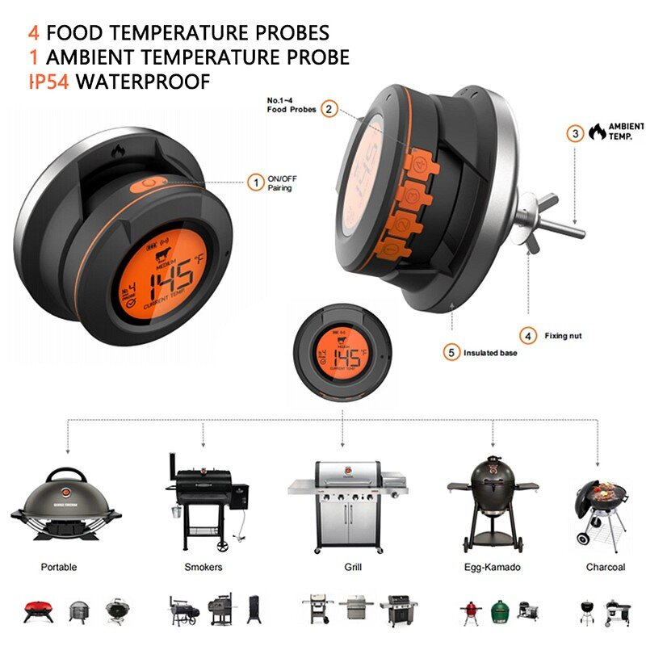
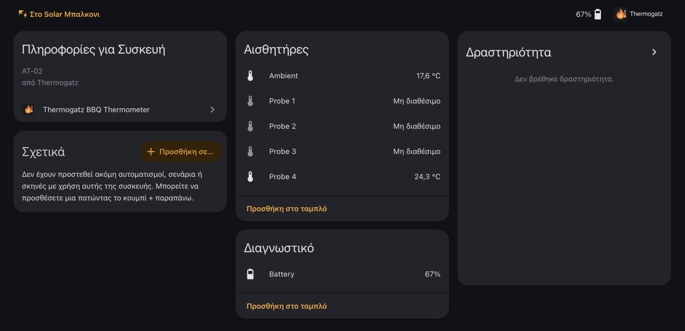

The [Thermogatz AT-02](https://www.bestprice.gr/search?q=thermogatz+At02) is a round Bluetooth grill
thermometer. It has four sockets for food probes and one ambient probe that goes through the wall of the
grill. It works well with its phone app, but the app is the only way to read it. There is no API.

I wanted the temperatures in Home Assistant, to graph a cook and get a notification when the meat is
done. So I wrote an integration for it.



The product picture is the manufacturer's.

## What you get



| Entity | |
|---|---|
| Probe 1 to 4 | food probe temperatures, unavailable when the socket is empty |
| Ambient | the grill temperature |
| Battery | diagnostic |

It updates every second, works through any Bluetooth adapter or ESPHome Bluetooth proxy that Home
Assistant uses, and reconnects on its own.

## How it works

The thermometer advertises as `AT-02` and needs no pairing. The integration connects, subscribes to one
characteristic, and asks for the status and the temperatures. From then on it sends one frame per second.

| | |
|---|---|
| Service | `0000cee0-0000-1000-8000-00805f9b34fb` |
| Write | `0000cee1-0000-1000-8000-00805f9b34fb` |
| Notify | `0000cee2-0000-1000-8000-00805f9b34fb` |
| Frame | `55 AA 00 <len> <cmd> <payload> <xor>` |

```text
55 aa 00 0f a1 | ff ff  ff ff  ff ff  05 50  ff ff  ff ff  00 bc | 04
                 p1     p2     p3     p4     p5     p6     ambient
                                      136.0 °C                18.8 °C
```

Seven slots in tenths of a degree, `ffff` meaning nothing plugged in. Battery comes from the status reply.

None of this is documented, so I took it from the phone app. I pulled the APK with `adb`, decompiled it
with jadx, found the UUIDs, the start-up sequence and the notification parser, and then replayed it
against the real thermometer from a Mac with bleak to confirm the numbers. The full protocol is in
[docs/protocol.md](https://github.com/phoinixgrr/thermogatz_ha/blob/main/docs/protocol.md) and the method
is in [docs/reverse-engineering.md](https://github.com/phoinixgrr/thermogatz_ha/blob/main/docs/reverse-engineering.md).

## Install

Add `https://github.com/phoinixgrr/thermogatz_ha` to HACS as a custom repository (category Integration),
install **Thermogatz BBQ Thermometer** and restart. The thermometer then shows up under *Discovered*.

An alert when the meat is done:

```yaml
- alias: BBQ probe 1 reached 74 C
  triggers:
    - trigger: numeric_state
      entity_id: sensor.at_02_5f3e_probe_1
      above: 74
  actions:
    - action: notify.notify
      data:
        message: "Probe 1 is at {{ states('sensor.at_02_5f3e_probe_1') }} °C"
```

## Good to know

- The thermometer accepts one Bluetooth connection at a time, so Home Assistant and the phone app
  cannot be connected together. Disable the integration entry when you want the app.
- Only the AT-02 is tested. Your mileage will vary on other models and devices.

## Where to find it

Source, docs and releases: **[github.com/phoinixgrr/thermogatz_ha](https://github.com/phoinixgrr/thermogatz_ha)**

This is an independent project, not affiliated with Thermogatz.


Happy Home Assistant grilling! 🥩🔥
